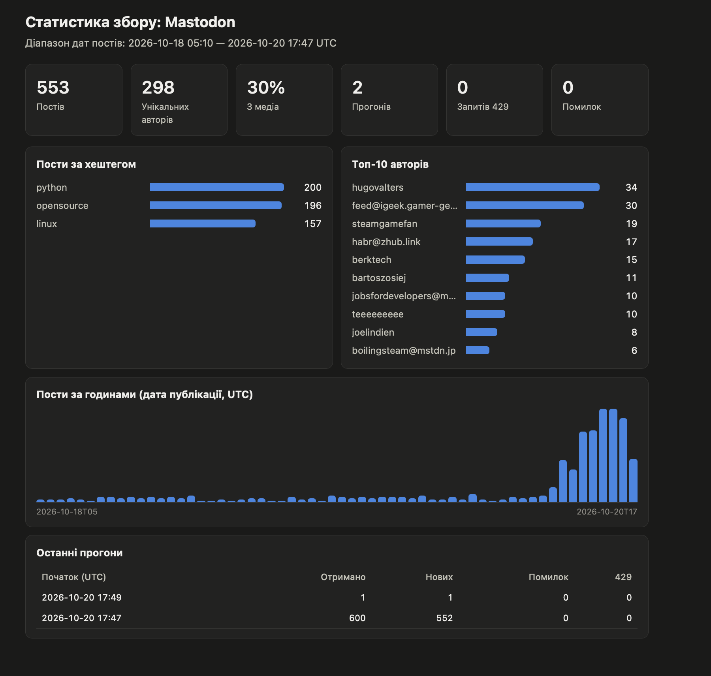

# Mastodon Incremental Collector

Стійкий інкрементний колектор публічних хештег-таймлайнів Mastodon (офіційне API, без обов'язкової авторизації).
Результат складається в єдину канонічну модель **author · url · date · text (+ media)** у SQLite, з експортом у JSONL.



## Можливості
- **Інкрементність**: курсори `<tag>:newest` / `<tag>:oldest` у таблиці `cursors`. Повторний запуск тягне лише нове (`min_id`), курсор зберігається після кожної сторінки.
- **Дедуплікація**: `UNIQUE(source, source_id)` і `UNIQUE(url)` + `INSERT OR IGNORE` → запуск ідемпотентний.
- **Ліміти**: пейсинг `REQUEST_DELAY` перед кожним запитом; 429 → очікування за `Retry-After` / `X-RateLimit-Reset`; проактивна пауза при `X-RateLimit-Remaining <= 1`; експоненційний backoff + jitter для 5xx та мережевих помилок. Усі `X-RateLimit-*` логуються.
- **Стійкість**: збій одного хештега не зупиняє інші; логи в консоль і `collector.log`; статистика прогонів у таблиці `runs`.
- **Бонуси**:
  - ротація кількох токенів (`MASTODON_TOKENS=a,b,c`): при 429/401 клієнт переходить на наступний токен (покрито unit-тестами);
  - проксі (`HTTP_PROXY_URL`; реалізовано, не тестувалося на живому проксі);
  - backfill історії (`--backfill`);
  - HTML-дашборд зі статистикою (`--dashboard`);
  - Dockerfile (зібрано й перевірено живим прогоном у контейнері).

## Запуск
```bash
python -m venv .venv && source .venv/bin/activate
pip install -r requirements.txt
cp .env.example .env            # за потреби змініть хештеги/інстанс

python -m collector.collect              # звичайний інкрементний прогін (невелика партія)
python -m collector.collect --backfill   # добрати старіші записи
python -m collector.collect --stats      # статистика
python -m collector.collect --dashboard data/dashboard.html   # HTML-дашборд (відкрити в браузері)
python -m collector.collect --export data/sample.jsonl   # приклад даних
```
Щоб набрати ≥200 записів: запустіть 2–3 рази (кожен прогін = `PAGES_PER_RUN × PAGE_LIMIT` на хештег).

### Docker
```bash
docker build -t mastodon-collector .
docker run --rm --env-file .env -v "$PWD/data:/app/data" mastodon-collector
```

## Тести
```bash
pip install pytest && python -m pytest -q
```
Тести (без інтернету):
- `tests/test_mock.py`: локальний мок-сервер (пагінація `Link`, один 429 з `Retry-After`); перевіряє інкрементність, відсутність дублів, backfill, експорт.
- `tests/test_rotation_dashboard.py`: ротація токенів на 429/401, повага до `Retry-After`, генерація дашборда.

## Структура
```
collector/config.py   конфіг з .env
collector/client.py   HTTP, пейсинг, backoff, ротація токенів
collector/db.py       SQLite, канонічна модель, курсори, експорт
collector/collect.py  логіка збору + CLI
collector/dashboard.py генерація HTML-дашборда
tests/                тести (мок-сервер, ротація токенів, дашборд)
```
